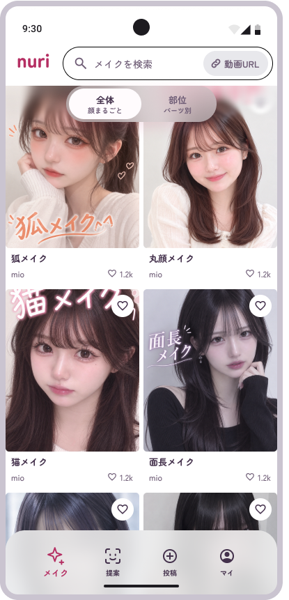
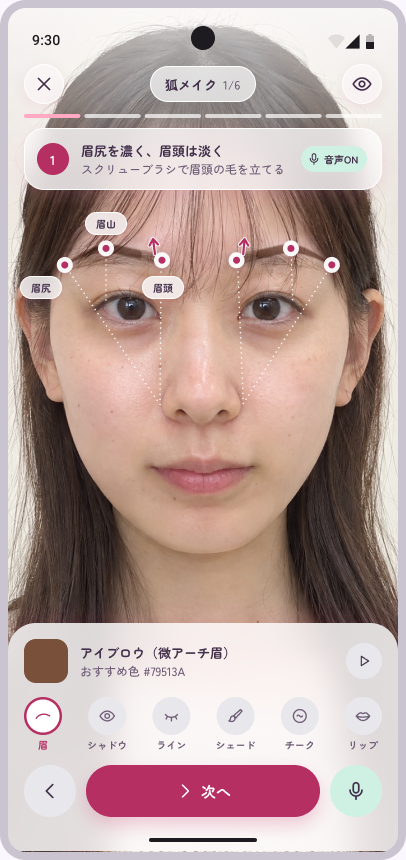
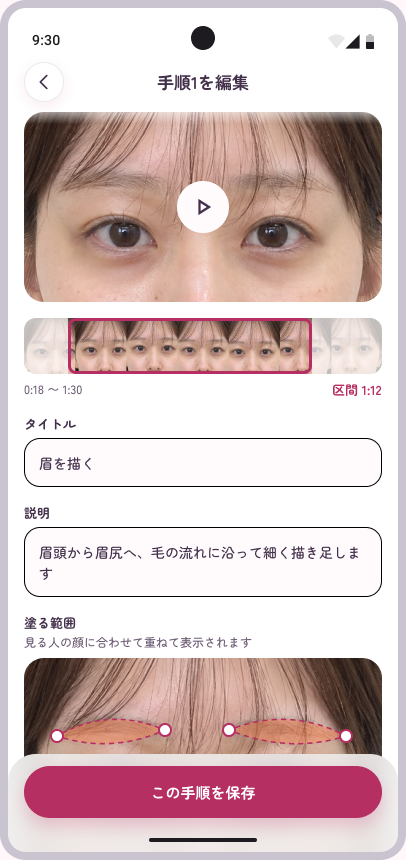
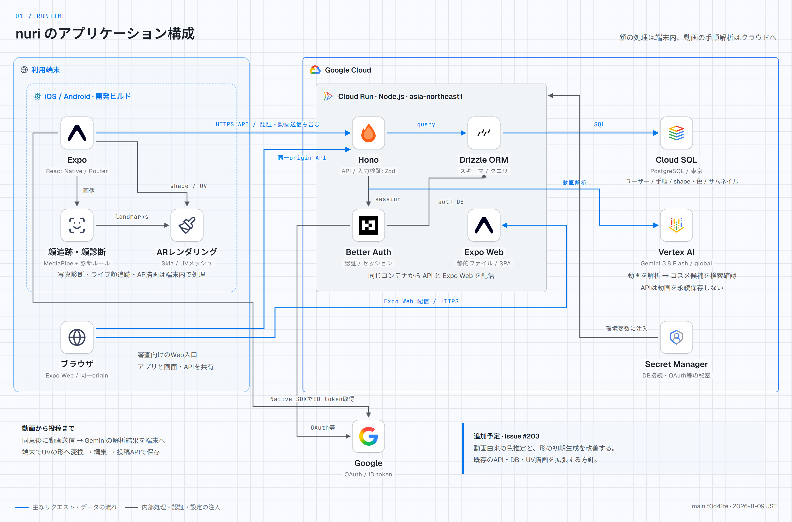
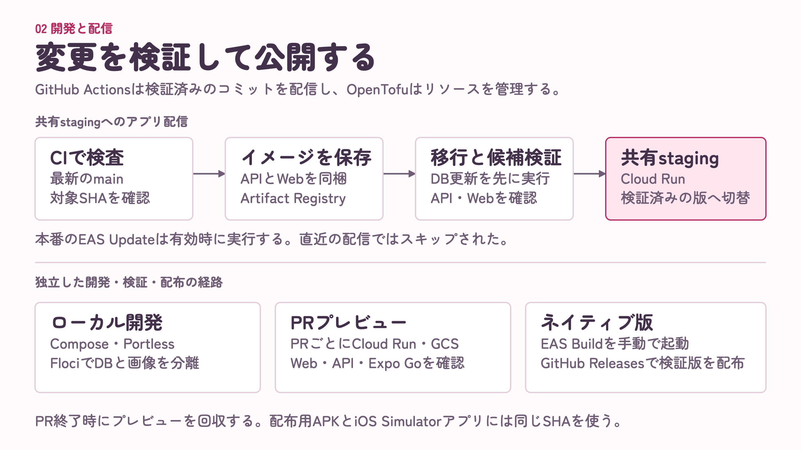

<p align="center">
  
</p>
<h1 align="center">nuri</h1>
<p align="center"><strong>自分の顔で、手順どおりに。</strong></p>
<p align="center">🪞 顔に重ねるARガイド　 ·　 📷 写真から顔タイプ診断　 ·　 🎬 動画から手順書</p>

お手本のメイクを見ても、自分の顔ではどこに、どんな形で塗ればよいか迷う。nuriは、メイクを手順ごとのレシピとして選び、インカメラに映る自分の顔へ塗る範囲と色を重ねながら再現するアプリです。写真から顔の特徴を知り、メイク動画から手順書を作って、編集・投稿できます。

[🎨 Figma / 実装plan](https://www.figma.com/design/dwoWsLmVBU5c0Hx0vlVWua/?node-id=21-11426) · [📋 要件定義](docs/requirements.md) · [🛠️ セットアップ](docs/setup.md) · [🏗️ 構成仕様](docs/architecture.md)

<table>
  <tr>
    <th>🔍 メイクを見つける</th>
    <th>🪞 自分の顔で手順を確認</th>
    <th>🎬 動画から作った手順を編集</th>
  </tr>
  <tr>
    <td></td>
    <td></td>
    <td></td>
  </tr>
</table>

上の画像は**Figmaのデザイン**です。実装のスクリーンショットではなく、画面内の文言・数値・ガイド表現は現在のアプリと異なる場合があります。[画像の出所と参照ノード](docs/images/readme/README.md)

## 💡 体験を支える仕組み

| 利用者の体験                                 | 技術上の仕組み                                                                                    | 実装への入口                                                                                      |
| -------------------------------------------- | ------------------------------------------------------------------------------------------------- | ------------------------------------------------------------------------------------------------- |
| 自分の顔の動きに合わせて、塗る場所を確認する | MediaPipeで端末内の顔の特徴点を追跡し、UV座標で持つ塗布範囲をSkiaで顔へ重ねる                     | [顔追跡](apps/mobile/modules/face-tracker)・[UV描画](apps/mobile/src/components/face-texture.tsx) |
| 写真から顔の特徴を知る                       | 顔の特徴点から輪郭や目元などの比率を算出し、ルールに基づいて分類。写真の診断処理は端末内で完結    | [診断ロジック](apps/mobile/src/lib/face-diagnosis.ts)                                             |
| メイク動画を、見返せる手順書にする           | 同意後に動画をVertex AIのGeminiへ送り、手順・時間区間・部位・コスメ候補・塗る範囲の意味情報を取得 | [動画解析](apps/api/src/modules/post-analysis/gemini.ts)                                          |
| 解析した手順を直してから投稿する             | 意味情報を端末でUVの図形へ変換し、手順や範囲を編集。レシピ・色・形・サムネイルをAPI経由でDBへ保存 | [初期形状](apps/mobile/src/lib/region-shape.ts)・[レシピAPI](apps/api/src/modules/recipes)        |

## ✨ できること

- 🔖 **レシピを探す・保存する** — 全体メイクや部位からレシピを探し、手順と使うコスメを確認。お気に入りに保存できます。
- 🪞 **顔に合わせてメイクする** — iOS・Androidの開発ビルドで、顔追跡と塗る範囲の重ね表示を使いながら手順を進められます。
- 📷 **写真から顔タイプを診断する** — カメラや選んだ写真から顔の特徴を読み取り、診断結果を確認できます。
- 🎬 **動画からレシピを作る** — 録画した動画や端末の動画から手順書を作り、内容を編集して投稿できます。
- 🔐 **Googleでログインする** — Better Authで認証とセッションを管理し、投稿やお気に入りなどをアカウントに紐付けます。

動画から生成する色は現在、部位ごとの既定値です。塗る範囲は意味情報から作る初期形状で、動画の画素から輪郭を直接抽出する方式ではありません。[動画由来の色推定と初期形状の改善](https://github.com/Kcvl-DfHack26/nuri/issues/203)を予定しています。SNSのURL取り込み画面は固定サンプルで、実際の投稿を取得する処理は未実装です。メールログインは[送信ドメインを用意してから提供](https://github.com/Kcvl-DfHack26/nuri/issues/177)する予定です。

📱 **主要機能の確認はiOS・AndroidのDevelopment Buildで。** WebにもAPIと連動したレシピ閲覧などはありますが、顔追跡AR・写真診断を含む一連の体験はネイティブ版で確認します。[端末で動かす手順](docs/setup.md)

## 🧰 技術スタック

<table>
  <tr>
    <td align="center" width="120"><br /><strong>Expo</strong></td>
    <td align="center" width="120"><br /><strong>React Native</strong></td>
    <td align="center" width="120"><br /><strong>Hono</strong></td>
    <td align="center" width="120"><br /><strong>Vertex AI</strong></td>
    <td align="center" width="120"><br /><strong>Drizzle ORM</strong></td>
    <td align="center" width="120"><br /><strong>OpenTofu</strong></td>
  </tr>
</table>

TypeScriptを中心に、端末内の顔処理とGoogle Cloud上の動画解析・データ管理を組み合わせています。依存バージョンは各workspaceの `package.json` と [`bun.lock`](bun.lock)で管理します。

| 領域            | 採用技術                                                              | 役割                                                                 |
| --------------- | --------------------------------------------------------------------- | -------------------------------------------------------------------- |
| アプリ・Web     | Expo SDK 58、React Native 0.88、Expo Router                           | iOS・Androidと、ブラウザで確認するExpo Web                           |
| UI・データ取得  | Expo UI、Uniwind、TanStack Query                                      | 画面部品、スタイル、サーバーデータのキャッシュ                       |
| 顔追跡・AR      | MediaPipe Face Landmarker、React Native Skia                          | 端末内の特徴点検出、UVメッシュへの描画                               |
| 動画解析        | Vertex AI、Gemini 3.8 Flash、Google Gen AI SDK                        | 手順と塗布範囲の意味情報の抽出、コスメ候補の検索確認                 |
| API・入力検証   | Hono、Hono Client、Zod、Node.js                                       | 型を共有するAPI、入力検証、認可                                      |
| 認証・DB        | Better Auth、Drizzle ORM、Cloud SQL / PostgreSQL                      | ユーザー・セッション・レシピ・手順・色・形・画像の保存               |
| 実行・配信基盤  | Cloud Run、Artifact Registry、Secret Manager                          | APIとWebの実行、コンテナ配信、秘密情報の注入                         |
| インフラ・CI/CD | OpenTofu、GitHub Actions、WIF、Expo EAS                               | リソース定義、検査、キーレス認証、ネイティブビルドとUpdateの配布設定 |
| 開発・検証      | Bun workspaces、Turborepo、Docker Compose、Bun test、Jest、Playwright | 開発環境、依存管理、単体・統合・Webの検証                            |

## 🏗️ アーキテクチャ



ライブ顔追跡・AR描画・写真診断は端末内で処理します。動画から手順を作るときは利用者の同意後にAPIへ送信し、Geminiの結果を端末で編集できる形に変換します。APIは解析用の動画を永続保存せず、投稿時にレシピと手順・画像をDBへ保存します。

構成図は2026年11月9日の確認時点のスナップショットです。図中の追加予定は現在の実装と区別しています。[画像の出所と確認範囲](docs/images/readme/README.md)・[🏗️ 構成仕様](docs/architecture.md)



mainのCI成功後、Actionsが同じコンテナイメージでDB migrationを実行し、候補revisionのAPI・Webを確認してから公開先を切り替えます。OpenTofuはリソース、DrizzleはDBスキーマ、Actionsはアプリの配信を担当します。

確認時点では、ActionsからのEAS Update自動配布とProduction Infrastructure用の認証変数は未設定です。Cloud Runへの配信成功と、端末に入っているアプリの更新は別に確認します。

## 🚀 開発を始める

[Expo + Hono + OpenTofu starter](https://github.com/ReoHakase/expo-hono-opentofu-starter)を土台にしています。初期設定、環境変数、Google Cloud・GitHub・EASの準備は[セットアップ手順](docs/setup.md)を参照してください。

ローカルサーバーはDocker Composeで起動します。ホストにGit、Docker Engine + Compose v2、Node.js 24以降、Portless 0.16.0を用意します。WindowsではWSL2のLinuxファイルシステムで作業し、Docker DesktopのWSL integrationを有効にします。

```sh
npm install --global portless@0.16.0
sh scripts/worktree-init.sh
# ホストで一度だけ。既存のHTTPS/443 proxyは再利用する
portless proxy start --https --port 443
PORTLESS_HTTPS=1 PORTLESS_PORT=443 portless compose up --build api metro
```

依存導入・未作成の環境ファイル生成・DB migrationが自動で行われます。API・MetroのURLとPostgreSQLのvolumeはworktreeごとに分離します。Dev Containerは編集・検査に使い、アプリの起動・停止はホストのPortlessで行います。

顔追跡などのネイティブ機能には**Development Buildが必要**です。Expo Goは初期のUI確認に限り、ネイティブモジュールを使う機能の確認には使えません。端末接続・ビルド・API接続は[セットアップ手順](docs/setup.md)に従ってください。

終了時は次を実行します。自worktreeのrouteとコンテナだけを終了し、volumeを保持します。

```sh
PORTLESS_HTTPS=1 PORTLESS_PORT=443 portless compose --profile '*' down
```

## 📂 リポジトリ構成

| 場所                                                                   | 役割                                              |
| ---------------------------------------------------------------------- | ------------------------------------------------- |
| [`apps/mobile`](apps/mobile)                                           | Expoアプリ、Web、UI、端末内の顔処理・AR・投稿編集 |
| [`apps/mobile/modules/face-tracker`](apps/mobile/modules/face-tracker) | iOS・AndroidのMediaPipe連携                       |
| [`apps/api`](apps/api)                                                 | Hono、認証・認可、DB、動画解析、Expo Webの配信    |
| [`apps/emulate`](apps/emulate)                                         | 開発用のGoogle・Resendエミュレーター              |
| [`packages/shared`](packages/shared)                                   | 共有Zodスキーマと純粋な処理                       |
| [`infra`](infra)                                                       | OpenTofuによるGoogle Cloudリソースの定義          |
| [`.github/workflows`](.github/workflows)                               | 品質検査、PRプレビュー、API・Webの配信            |
| [`apps/mobile/.eas/workflows`](apps/mobile/.eas/workflows)             | 開発ビルドとネイティブアプリの配信設定            |
| [`.devcontainer`](.devcontainer)・[`compose.yaml`](compose.yaml)       | コンテナの編集・検査環境とローカルサーバー        |
| [`docs`](docs)                                                         | 製品・構成・認証・開発運用の文書                  |

## 🧪 検証とよく使うコマンド

ホストにBun 1.4.4を用意して `bun install --frozen-lockfile && bun run setup` を実行すると、以下の短縮コマンドを使えます。Composeを操作するコマンドはホストで実行してください。

| コマンド                                        | 内容                                               |
| ----------------------------------------------- | -------------------------------------------------- |
| `bun run setup`                                 | worktree設定と未作成のアプリenvを生成              |
| `bun run dev` / `bun run dev:devices`           | DB・API・Metroを起動 / Simulator・Emulator用に起動 |
| `bun run check`                                 | 整形、型付きlint、型検査、Bun/Jestテスト、Fallow   |
| `bun run test:integration`                      | PostgreSQLを使った認証・認可テスト                 |
| `bun run test:e2e`                              | Chromium・WebKitのWeb E2E（要ローカルDB）          |
| `bun run db:generate` / `bun run db:migrate`    | migration生成 / 適用                               |
| `bun run db:seed`                               | ローカルのサンプルデータを用意                     |
| `bun run doctor` / `bun run export:mobile`      | Expoの互換性確認 / iOS・Androidのbundle生成        |
| `bun run build:api`                             | Node.js向けAPI build                               |
| `bun run services:up` / `bun run services:down` | DB・API・Metroをバックグラウンドで起動 / 停止      |

通常のCIにGoogle CloudやExpoのsecretは不要です。実際の動画解析やクラウド配信には対応する環境設定が必要です。検証の分担と実機確認は[テスト方針](docs/testing.md)を参照してください。

## 📚 詳細ドキュメント

- 製品・デザイン：[要件定義](docs/requirements.md)、[UI方針](docs/ui.md)、[作成時のアプリ概要](docs/overview.md)
- 構成・運用：[アーキテクチャ](docs/architecture.md)、[認証](docs/auth.md)、[PRプレビュー](docs/preview.md)
- 開発・検証：[セットアップ](docs/setup.md)、[テストと実機チェック](docs/testing.md)、[エージェントの作業規約](AGENTS.md)
- [Expoプロジェクト](https://expo.dev/accounts/kcvlb4/projects/nuri)
