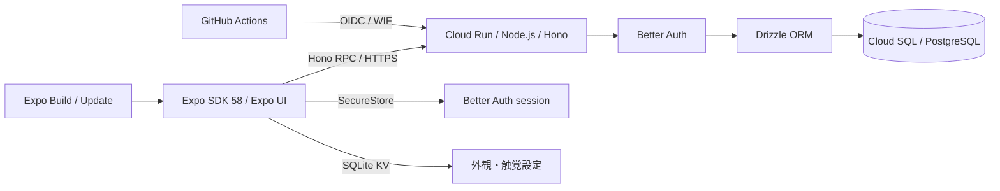

# アーキテクチャと技術選定

基準は2026年11月5日の[Expo技術選定検討](chatgpt-conversation://6aec01ec-6938-83e8-94df-24f41ae3ad55)と提供された開発仕様。依存関係の実際の解決版は `bun.lock` を正本とする。

## 採用構成

- Node.js 24、Bun 1.4.4、Expo 58、React Native 0.88、React 19.3。ネイティブ依存は `expo install` で互換版を選ぶ。
- Bun Workspaces + Turborepo。モバイルのネイティブモジュールを一つに解決するため、Bunの **hoisted linker** を明示する。
- Expo Routerは画面ルーティング専用。Honoを別サーバーとしてCloud Runで動かす。
- `@starter/api/contract` は `AppType` のtype-only公開入口。モバイルはHono RPCの型を再利用し、API実装をbundleへ混入させない。
- Zodは入力検証と共有モデル、DrizzleはPostgreSQLスキーマとmigrationを所有する。Drizzle ORM / Kitは `1.0.0-rc.5` に固定する。
- Better Auth 1.7.17 + Expo pluginでGoogle OAuth・email magic link・passkey。セッションはSecureStore。ローカルはVercel Emulateを使い、Google Cloudや実プロバイダのキーなしで認証する。

Drizzle 1.0 RCは[公式の移行手順](https://orm.drizzle.team/docs/upgrade-v1)に従って採用する。DB接続は `drizzle({ client: pool })` を使い、認証のschemaはBetter Authのadapterへ渡す。Kitで廃止された `strict` 設定は削除した。既存migrationは `drizzle-kit up` でSQLとsnapshotを同じディレクトリへ移し、snapshotをversion 9へ変換した。SQLの内容・ハッシュと適用順序は保持し、テーブルの作り直しは行わない。

## UIと端末内データ

下のタブはPlan Aのメイク・提案・投稿・マイの4つで（構成は次の段落）、マイはPlan Aの⑰マイページで、歯車から⑰-2プロフィール設定を開き。メイクの流れ（①②③⑤⑥⑦⑩⑪）はFigma Plan Aの見た目を再現し、①⑤のレシピはAPIから読む（下記）。⑤⑦⑪の手順もAPIから読む。ARの重ね表示・⑥の商品詳細と、まだAPIを読まない画面（⑩・提案・マイ）のレシピは `src/components/recipes.ts` の固定データで持つ。画像を含むため、`src/lib` ではなくUIと同じ層に置く。色と文字はFoundationsの値を `global.css` へ追加し、ネイティブのアイコン色は `useTokenColor` で同じCSS変数から読む。投稿タブはPlan Aの⑫-1（動画を撮る）を開き、⑫-2〜⑫-9は `src/app/post` のStackで進む。下書きは `PostDraftProvider` が端末内の画面状態として持ち、流れを抜けると捨てる（投稿の保存は下記）。既存のSNSサンプルのタイムラインは同じタブのStackの `/timeline` に残し、ログイン後の「タイムラインに戻る」から開く。X型のFlatList、投稿、反応はReusables Text／Button + Uniwind Free 1.13.2／Tailwind CSS 4.3.4、設定とOS操作は共通 `@expo/ui`。SF SymbolsとMaterialの両ソースを指定する。

下のタブ（#96）は、iOSではNative Tabsのままにし、iOS 26のLiquid GlassをPlan Aの `TabBar/Glass` に近い見た目として使う。AndroidのNative TabsはMaterialの不透明な全幅バーと選択中のピルを描き、角の丸み・高さ・アイコンの大きさ・下の画面が透ける表示を設定できない。そのため、Androidと（web）では `expo-router/ui` の `Tabs`・`TabList`・`TabTrigger`・`TabSlot` で `TabBar/Glass` を描く（`src/components/app-tabs.tsx`、iOSは `app-tabs.ios.tsx`）。これはスターターの「移動は標準の部品」と異なるが、nuriではPlan Aを正とするため採用した。上16pt・タブ58pt×76pt・下18pt（システムのナビゲーションがそれより高ければその高さ）、上の角28pt、85%不透明の `--color-tab-glass`、選択中はアイコンを10%大きくし、アイコンと12ptの文字をrose、それ以外は10ptのink。アイコンはPlan AのSVG（`assets/plan-a/icons/tab-*.svg`）。React Nativeには背景のぼかしがないため、Plan Aの15ptのぼかしは描かない。戻る操作はNative Tabsと同じ `initialRoute`（ほかのタブからはメイクへ戻る）。各タブは `accessibilityRole="tab"` と選択状態を持つ。バーは画面の上に重なるため、タブ内の画面にはバーの高さ（測った値）をsafe areaの下の値として渡し、各画面はiOSと同じく `useSafeAreaInsets().bottom` で下を空ける。iOSのScrollViewは自動調整するため、Androidだけ下を足す画面（マイ・診断結果・タイムライン・読み込み中などの `Screen`）もある。キーボードを開くと画面が縮んでバーが入力欄を隠すため、キーボードの表示中はバーを隠す（Materialのバーもキーボードの下になる）。

起動画面（⓪）は、フォントの読み込み中にRoot Layoutがアプリ内の画面として表示する。ネイティブのスプラッシュは新しいビルドが必要なため変えない。ロゴの文字はフォントの読み込み前なのでシステムフォントで描く。ログイン（⑱）はPlan Aのライト配色で、ログイン成功後と「ゲストで参加」ではログインを求めた元の画面へ戻り、履歴がなければメイクへ移る。メールのリンクから戻る場合は従来どおり投稿タブを開く。

レシピはAPIの `recipe`・`product`・`recipe_product`・`recipe_step` 表に置き、未ログインでも `GET /api/recipes`（20件ずつのoffsetページング）と `GET /api/recipes/:id` で読める。レシピのIDは `fox` のような英小文字・数字・ハイフンのslugで、画面の固定データ（一覧の写真など）と同じIDで結び付く。手順（#30）は `recipe_step` に順番・部位・短い名前・見出し・補足・使う物・おすすめ色を持ち、すべて必須にする。部位の一覧 `makeupParts` は `packages/shared` に置く。詳細のAPIが手順を順番どおりに返し、⑤の手順・⑦の進行・⑪の重ねる手順の一覧はこれを使う。手順のないレシピは⑤で完成写真を出して開始を準備中にし、⑦は「手順が見つかりません」を出す。Expo Goの⑦が代わりに出すPlan Aの重ね画像は狐メイク用で、手順のあるレシピに部位ごとで使う。seedは狐メイクに5手順を入れる（Plan Aでアイコンだけだったリップは入れない）。seedは手順を追加・更新するだけで消さないため、seedの手順を減らすときは開発用DBの余った手順を手で消す。⑥はPlan Aの商品詳細データがある商品だけ開く。`like_count` はサンプルの見本の人気で、ハートの数はこれにお気に入りの数を足して返す（#191）。画像はAPIが `/sample-recipes/*` で配り、DBにはAPI上のパスか絶対URLを保存する。メイク品の購入先（#95）は `product.purchase_url` に持ち、https以外を `packages/shared` の `purchaseUrlSchema` で拒む。⑤は購入先のあるメイク品にだけ「買う」を出し、アプリ内ブラウザ（`expo-web-browser`）で開く。見本のメイク品は架空のため、seedは実在の通販サイトで商品名を検索するURLを入れ、Plan Aどおりチークだけに付ける。旧 `purchasable` 列は読まなくなったが、動いている旧版のAPIが選択するため、入れ替え後に別のmigrationで消す。⑤の投稿者は `/users/[id]` のプロフィールを開き、⑰と同じレシピの一覧（`RecipeSection`）で `GET /api/recipes?author=` を出す。フォロワー・フォロー中・いいねの数は実際の値を出す（#195）。⑩の右上はPlan Aの保存（準備中）に、レシピ名を含む文だけを渡す共有を加えた（完成の写真は渡さない）。Plan Aは⑪を非表示にしていて⑩からの導線もないため、⑩の「メイク前と比べる」を外した。⑪の画面は `/recipes/[id]/compare` に残る。

お気に入りは `recipe_favorite`（ユーザー×レシピ、主キーで冪等）に置く。`PUT`・`DELETE /api/recipes/:id/favorite` と `GET /api/me/favorites` はログインが必要で、レシピの一覧・お気に入り一覧・詳細は，ログイン中なら `favorited` を返す．ハートはお気に入り一つにまとめ，①⑭のカード・③・⑤で付け外しできる（#191）．⑤右上の保存（ブックマーク）は無くした．ハートの数（`likeCount`）は，`recipe.like_count`（サンプルの見本の人気）にそのレシピのお気に入りの数を足したもの．投稿したレシピは `like_count` が0なので，お気に入りの数そのものになる．押したときは `useFavorite`（`src/components/use-favorite.ts`）が，一覧・お気に入り一覧・詳細のキャッシュにある同じレシピだけを先に書き換え（`setCachedFavorite`），失敗したら戻す．一覧は取り直さず，お気に入り一覧だけを取り直す．⑰は自分が作者のレシピ（`GET /api/recipes?author=`）とお気に入りを表示する。フォローは `follow`（フォローする人×される人，主キーで冪等，自分自身は `CHECK` で拒否）に置く（#195）．`PUT`・`DELETE /api/users/:id/follow` はログインが必要で，自分は400，存在しない・公開しない利用者は404を返す．`GET /api/users/:id` はフォロワー数・フォロー中の数・いいね（その人のレシピのハートの数の合計．レシピごとの数と同じ `likeCountOf` で数える）と，ログイン中ならフォローしているかを返す．⑰と他人のプロフィールは，この数を「フォロワー・フォロー中・いいね」として出す．フォローは⑤の作者の行と他人のプロフィールで押せ，`useFollow`（`src/components/use-follow.ts`）がキャッシュにあるその人と自分のプロフィールの数だけを先に書き換え，失敗したら戻す．最後のフォローが終わった後にプロフィールを取り直す．他人のプロフィールは⑰と同じ見た目で，スターターの文章投稿の欄は出さない（タイムラインは残っている）．Plan Aにデザインがないため，⑰の構成を使った．フォロー中の人の新着の通知は作らない．ゲストがお気に入りや⑫の撮影・動画の選択を押すと⑱へ進み、ログイン後は元の画面へ戻る（Googleとパスキーはログイン後すぐ、メールのリンクは⑱に戻った後の「もとの画面に戻る」で）。

③の投稿（#98）は，⑫-3で録画の区切り（`draft.video.marks`）ごとに手順の下書きを作る．区切りから次の区切り（最後は動画の終わり）までを1手順とし，「動画から」で選んだ区切りのない動画は全体で1手順にする．手順は投稿の上限（`recipeStepsMax`，20）までで，⑫-2の「手順を区切る」は19回で押せなくなる．区切りを手順に変える処理は `src/lib/post-steps.ts` の純粋関数 `planSteps` に分け，Geminiでの部位・見出し・説明の提案（別Issue）はここを差し替える．部位の初期値は②の並び順で，利用者が⑫-5の `@expo/ui` のPickerで選び直す．手順の写真は各区間の先頭のフレームを `expo-video-thumbnails` で切り出し，端末内だけで使う．Plan Aの⑫-7にタイトルの欄がないため，メッセージの上に必須のタイトル（40文字以内）を置く．投稿は⑫-8の「投稿」から行い，送る直前にAlertで「サムネイルの写真（顔が写ることがある）と手順をサーバーに送って公開する．動画は送らない」ことの同意を取る．`POST /api/recipes`（ログインが必要）は `recipeInputSchema`（`packages/shared`）で検証し，レシピと手順を1つのトランザクションで保存する．IDは，下書きを作るときに端末が作るUUID（`key`）に `p-` を付けたものにする．応答が失われて再送しても1件だけ保存し，内容は最後に送ったもの（写真を差し替えた場合も含む）にする．同じIDがほかの人の投稿なら409を返す．部位なし（全体のレシピ）・保存数0・取り込み元なしとする．サムネイルはbase64のJPEG（復号後1.5MB以下，先頭のJPEGマーカーを検証）で受け取り，Cloud Storageを増やさずに `recipe_image` 表（`bytea`）へ置いて，公開の `GET /api/recipe-images/:id` から `image/jpeg`・`nosniff`・長期キャッシュで配る．この経路だけ本文の上限を2.5MiBにし，上限を超えた本文には413を返す．端末では切り出した画像が上限を超える場合に画質を下げて切り出し直す（ネイティブの依存を増やさないため `expo-image-manipulator` は入れない）．手順の `uses` は⑫-6で選んだコスメの名前（公開しない設定か未選択なら部位名），`color` は最初のコスメの色か部位ごとの既定色（`partColors`）．⑫-6の候補はPlan Aの見本で，DBの商品に結び付かないため，⑤の「使うメイク品」には保存せず，⑫-8のプレビューにも出さない．公開しない設定では，名前も色も送らず部位の既定にする．投稿中に流れを閉じても保存は続くが，⑫-9は開かない．成功するとレシピの問い合わせ（`['recipes']`）を無効にして⑫-9へ進み，⑫-9の「投稿を見る」は新しいレシピの⑤を開く．保存したIDを下書きに持ち，成功のあとは送らない．失敗した場合は下書きを残してエラーを出し，もう一度「投稿」を押せばやり直せる．

⑫-3の動画の解析（#142）は，ログインが必要な `POST /api/post-analyses` で受ける．動画（multipart，30MBまで）と録画中の区切りの時刻をリクエストのまま Vertex AI の `gemini-3.8-flash` へ1回だけ送り，題名・手順（区間・部位・説明・塗った範囲の指定）・コスメの候補を返す．動画は保存しない．塗った範囲の指定は，決めた目印・形・長さの選択肢だけで返し（`packages/shared` の `postAnalysisSchema`），特徴点の番号には端末で直す．コスメは Grounding with Google Search で1件ずつ確かめる．Gemini の答えの型は Zod から JSON Schema にし，Vertex AI が受け付ける項目だけを渡す．混雑の503は1回だけ再試行する．`VERTEX_PROJECT` がない環境（ローカルやCI）は503 `analysis_unavailable` を返し，Gemini の失敗や型に合わない答えは502 `analysis_failed` を返す．

手順の区間の時刻（#185）は，Gemini に「分:秒」（例：1:07）の文字列で答えさせ，API の中で秒に直して返す．秒の数で答えさせると，1分を過ぎた時刻を 1:07 のつもりで 107 と書くことがあったため．読めない時刻の手順は捨てる．録画中の区切りも「分:秒」で Gemini に渡す．

⑫-3（#151）は，APIが設定されていれば，動画を送る直前に Alert で同意を取る（「やめる」は⑫-1に戻る）．同意すると `expo/fetch` で動画（ファイルのまま）と区切りの時刻を `POST /api/post-analyses` に送り，Gemini の手順（区間・部位・説明）と題名，使ったコスメを下書きに入れる．コスメは手順に選ばれた状態で入れ，⑫-5で外せる．APIがない環境，30MBを超える動画，503・失敗・通信の失敗では，理由を伝えて区切りから手順を作る（`planSteps`）．録画は 720p・1Mbps（iOSは `avc1`）で，約4分までが上限に収まる．「動画から」はiOSで中くらいの大きさに書き出す．

⑫-3で送る動画が30MBを超える場合（主に「動画から」で選んだ動画，#169）は，送る前に `react-native-compressor` で端末内で長辺1280・1Mbpsに縮め，位置などのメタデータは写さない．縮めた動画は下書きの一時ファイルとして流れを閉じると消し，閉じると圧縮もやめる．撮影した動画はもともと小さいので縮めない．このライブラリは `react-native-nitro-modules` を使うネイティブの依存なので，開発ビルドの作り直しが必要．

⑫-8の投稿の確認（#182）は，見出し「レシピを投稿しますか？」だけの Alert にし，本文は出さない．写真を送るのは利用者が投稿を選んだときだけ，という方針は「投稿する」を押す確認で満たす．

⑫-3の塗った範囲（#156）は，Gemini が返した目印・形・長さを，端末の `src/lib/region-shape.ts` の純粋関数 `regionShape` で #138 の形（`makeupShapeSchema`，最大8本）に直し，手順の `shape` として下書きに持つ．⑫-8で `recipeStepInputSchema` の `shape` として送り，`recipe_step.shape` に保存する．目印は MediaPipe の特徴点の番号に対応させ，線の太さと長さは Gemini に聞かずに目の幅から決める．眉は眉の上下の輪郭の中央を通る線（眉の太さまで），まぶたの線はまぶたの輪郭に沿う線にし，目の中と開いた口は塗らない．頬紅などの楕円は始点（例：頬骨の上）を中心に置き，終点（例：こめかみ）は傾きにだけ使う．眉・目・頬など左右のある部位は，Gemini が片側だけ塗ったと答えても両側に描く．両側に描くかは目印で決め，Gemini が答えた左右・中央は使わない（同じ範囲が左右で2つ返っても1本にする）．⑫-5で部位を変えた手順は範囲を消す．投稿したレシピ（IDが `p-` で始まる）は，⑦⑩で範囲のない手順に部位の標準の模様を重ねない．

⑫-5（#181）は，手順の区間を `expo-video` で端末内だけで再生し，区間の終わりで止める．再生中に画面を離れると止める．動画の枠は手順の場面の縦横の比に合わせ，縦長の動画は高さ420ptまでにする．区間のバーの両端（開始は「>」，終了は「<」の白丸）をつまんで開始と終了を動かし（ジェスチャーの依存を増やさず React Native の Responder で作る．読み上げでは1秒ずつ動かす），動かしている時点の場面を動画に出す．指を離すと隣の手順の区間も合わせて直し（`src/lib/post-steps.ts` の `moveSegment`，1手順は1秒以上），開始が変わった手順は場面を切り出し直す．解析で読み取った範囲と説明は変えない．⑫-3では，Gemini が動画の長さより後に始まると答えた手順を捨てる（区間がマイナスになるため）．`expo-video` はネイティブの依存なので，開発ビルドの作り直しが必要．

⑫-2（#186）は Plan A の「手順を区切る」と区切りのバー，「手順N を撮影中」を出さない．手順は Gemini が動画から見つけ，録画の区切り（`marks`）は空で⑫-3へ渡す．⑫-4の「手順を追加」は，⑫-5と同じバー（動画全体）の両端で新しい手順の開始と終了を選び，その区間を新しい手順にして（`insertSegment`）新しい手順の⑫-5を開く．重なった前後の手順は新しい手順に合わせて短くし，新しい手順がある手順の中に収まる場合は，その手順の前の部分だけを残す．新しい手順は前の手順と同じ部位で，見出し・説明・コスメ・範囲は空にする．ほかの手順がまるごと隠れる区間，ほかの手順が1秒より短くなる区間，手順が上限のとき，動画の長さがわからないときは追加できない．開始が変わった手順は場面を切り出し直す．⑫-7のサムネイルも，⑫-5と同じく動画の縦横の比の枠（`VideoBox`）で出す．

⑫-5の「塗る範囲」（#196）は，Plan A の見本の代わりに，手順の場面（区間の先頭のフレーム）の顔に解析した範囲（`shape`）を部位の色で重ねる．顔の特徴点は⑥と同じ `detectFaceAsync` で取り，描画は⑦⑩と同じ `useShapeTexture` と `FaceTexture` を使う．ふだんはサムネイルのように左右両側が入る程度に拡大し，「編集する」で片側の点を大きく出す．点はタッチか「前の点」「次の点」で選び，「上へ・下へ・左へ・右へ」で選んだ点だけを展開図の上で少しずつ動かす（`src/lib/area-edit.ts`）．点の丸の位置は，描画と同じ顔の三角形の網で展開図から場面に直して出す．左右対称の範囲は片側の形を鏡のように描くので，反対側も同じように変わる．「太く・細く」で線の太さを変え，「範囲を消す」でなくす．範囲がない手順は「範囲を追加」で部位ごとの基本の形（`defaultShape`．解析と同じ `regionShape` で作る）から始める．ベース・シェーディング・ハイライト・チークは顔の広い範囲に塗るので拡大を弱くする．Expo Go や顔を見つけられない場面では理由を文で出す．

⑫-5の「この手順を削除」（#201）は，確認のあと手順を下書きから消して⑫-4に戻る．消した手順の区間はどの手順にも入らない空きになり，隣の手順のバーで広げられる．レシピには手順が1つ以上要るため，最後の1つは消せない．

⑫-8の「塗る範囲」（#202）は，Plan A の見本の顔写真（`face-bare.jpg`）に，範囲のある全部の手順の範囲を⑫-8の手順の色で重ねる．利用者の顔の写真は使わない．見本の写真の468個の特徴点は PC の MediaPipe Face Landmarker で一度だけ求めて `src/lib/sample-face.ts` に持ち，顔の追跡のない Expo Go でも描ける．描画は⑦⑩と同じ `useShapeTexture` と `FaceTexture`．範囲のある手順がないときは出さない．

⑫-8の投稿の確認（#196）は，本文「サムネイルと手順が、だれでも見られるように公開されます。」を出す．iOS は標準の Alert（見出しが中央，2つのボタンが左右）のまま，Android は Material の Alert が見出しを左寄せ・ボタンを右寄せにするため，`@expo/ui` の Jetpack Compose の `BasicAlertDialog` で見出しを中央に，「キャンセル」と「投稿する」を左右に置く（`post-confirm.android.tsx`）．

SNS取り込み（④）は、ホームの「動画URL」からルートStackのformSheet `/import` を開き、入力・読み取り中・完了・失敗・保存完了を一つのシート内の状態で切り替える。取得方法と権利条件が未決のため、URLは端末内で対応サービス（Instagram・YouTube・TikTok）の投稿URLかを判定するだけで、通信せず固定の見本（`src/components/sns-import-sample.ts`）を表示し、何も保存しない。④-4はシートの上に `fullScreenModal` で重ねる。iOSのネイティブStackはモーダルの後に通常のpush画面を置くとシートの下へ積むため、戻るとシートへ帰れるようにモーダルを重ねる。④-4の保存は `dismissTo` で `saved=1` を渡し、シートを④-5にする。

マイページ（⑰）は、名前と写真をセッションから，フォロワー・フォロー中・いいねの数を `GET /api/users/:id` から表示し，自分のレシピとお気に入りを並べる（#195）。ログインしていない場合はゲストとしてログインへの入口を出す。⑰-2の表示名・ユーザーID・自己紹介・公開設定は、認証済みの `GET/PATCH /api/me/profile` で読み書きし、画面で変更した項目だけを送る。再取得に失敗した間は保存を無効にし、編集途中の入力を保つ。ユーザーIDは小文字英数字とアンダースコアの3〜20文字で一意、自己紹介は42文字以内とし、ZodとDBの一意制約で守る。未設定のユーザーIDは `null` とする。公開しない利用者の `GET /api/users/:id` は、本人以外には404を返す。公開オフではプロフィール画面を本人だけが閲覧でき，フォローもされない（既にフォローしていた人の数には残る）。公開済みの投稿・レシピに含まれる名前と写真は引き続き表示されることを設定画面にも明記する。顔タイプ・通知・写真の変更・アカウントの削除は準備中として無効にする。Plan Aの⑰-2にある「アカウント」を最後の設定グループとして、メールアドレスの下にGoogle連携状態とパスキーの登録件数を表示する。パスキーは行を展開して、その場で確認・追加・削除できる（[認証](auth.md)）。Plan Aで非表示の⑮コスメ一覧と⑰-3〜⑰-6持っているメイク品は作らない。⑯色味チェックは、どの商品から開くかの設計ができるまで作らない。

提案タブ（⑬⑭）は、写真から顔のタイプと眉を端末内で診断する（#84）。⑬の「写真から」はシステムの写真ピッカーを使う。「カメラで診断」は `face-tracker` の前面カメラを表示し、不要なライブ追跡を止めて、「撮影する」でその時点のフレームをJPEGとしてアプリのキャッシュに保存する。ライブ追跡で顔が検出されたかどうかは撮影条件にしない。権限・起動エラーは画面に案内し、カメラを閉じて再試行できるようにする。iOSのライブ追跡モデルは、追跡が必要な最初のフレームで初期化する。両方の写真を同じ `detectFaceAsync`（MediaPipe Face LandmarkerのIMAGEモード、同じモデル）で診断し、別の推論の仕組みは加えない。Androidは写真をEXIFの向きに合わせて回し、長辺1280px以下に縮めてから渡す。iOSは `UIImage` の向きを `MPImage` に渡す。判定は `src/lib/face-diagnosis.ts` の純粋な関数で、目の傾きを除いた座標で測る。鼻先が頬の中点から頬の幅の8%以上ずれる写真は正面でないとして撮り直しを案内する。眉は#47の境目と、Face Landmarkerだけの偏りの補正で5種に分ける（画像から眉毛を探す方法はまだ作っていない）。顔タイプの基準はチームで未決のため、MediaPipeの標準メッシュ（平均的な顔）を卵型の目安にした仮の基準で分ける。⑭の根拠表示（#170）は採用したFigma A案に合わせ、「あなたの顔の特徴」の下に輪郭・目の傾き・顔のバランスを図、判定名、既存の説明で並べる。図はFigmaから取得した静的SVGで、計測した顔の描画ではない。依頼により図の注釈と仮基準・端末内処理の補足文は画面に置かず、中顔面の「目安」は残す。⑭は結果を画面のパラメータで受け取り、おすすめはサーバーのレシピ一覧から「〈顔タイプ〉向け」のタグを持つものを先に3件出す。一覧APIはそのためにタグも返す。写真・特徴点・結果はサーバーへ送らない。⑭の画面パラメータはZodで検証し、写真はカメラ・写真ピッカーが返す `file:///` のURIだけを表示する。外部URLや不正な型は写真なしとして扱う。撮影したJPEGは診断結果用にアプリのキャッシュへ置き、別の結果に置き換えたときか次回起動時に削除する。「前回の診断」はアプリを開いている間だけ直前の結果を開く。ほかの部位の診断と肌のトーンは準備中と表示する。Expo Goにはこのモジュールがないため、ボタンを無効にして開発ビルドを案内する。

顔追跡（要件定義11章のPoC-1、#25）は、アプリ内のExpo Module `apps/mobile/modules/face-tracker` が持つ。ネイティブのビューが前面カメラ（iOSはAVFoundation、AndroidはCameraX）を開き、各フレームを端末内でMediaPipe Face Landmarkerの `LIVE_STREAM`（iOSは `MediaPipeTasksVision` 1.0.0、Androidは `com.google.mediapipe:tasks-vision` 1.2.2）に渡す。特徴点は、正立・左右反転なしのフレームに対する0〜1の座標としてビューのイベントでJSへ送り、`src/lib/face-landmarks.ts` がプレビューと同じ拡大・切り抜き・左右反転で画面座標へ写す。確認画面はReact Native Skia（2.14.0）で点を描く。映像も特徴点もサーバーへ送らない。ただしMediaPipe Tasks（Android、tasks-core 1.2.2）は、利用統計（パッケージ名、アプリの版、タスク名、実行モード、CPU・GPU別の入力数、遅延、エラーコード）をGoogleのdatatransportで送る。映像と特徴点は含まない。エミュレーターのlogcatで送信の予約（`COREML_ON_DEVICE_SOLUTIONS`）を確かめた。ストアのデータの申告に関わるため扱いを決める必要があり、iOS（`MediaPipeTasksVision`）が送るかはまだ確かめていない。Androidはプレビューを `PreviewView` の `PERFORMANCE`（SurfaceView）で出す。`COMPATIBLE`（TextureView）は毎フレームの映像をアプリの描画スレッドが写すため、エミュレーターでは画面全体の描画が遅れた。推論はGPUを先に使う。GPUの推論器は作ったスレッドでしか使えないため、作成・推論・切り替え・終了をすべて解析スレッドで行う。GPUを開けないとき、エラーが届いたとき、150フレーム（30fpsで約5秒）続けて結果が返らないときにCPUへ切り替える。tasks-vision 1.2.2は、フレームを送る途中で起きたGPUのグラフのエラーをログに出すだけで、エラー通知を呼ばないため（エミュレーターのGLで確認）。カメラには `setTargetFrameRate` で30fpsを求める。指定しないとエミュレーターのカメラは15fpsになった。CameraXはアプリ全体で共有するため、外すのはこのビューのユースケースだけにする。iOSはCPUの推論とカメラ既定のfpsのまま（実機で試せていない）。モデル `face_landmarker.task`（float16の版1、Apache-2.0、SHA-256 `64184e229b263107bc2b804c6625db1341ff2bb731874b0bcc2fe6544e0bc9ff`）はモジュールの `assets/` に1つだけ置き、iOSはモジュール直下のpodspecのresource bundle、AndroidはGradleのassetsから読む。比較した案のうち、react-native-vision-camera v5はフレーム処理のプラグインをNitro Moduleとして自作する必要があり依存も増える。`react-native-mediapipe` は2024年以降更新がなく、旧版のvision-camera前提。`react-native-vision-camera-face-detector` はML KitでMediaPipeではない。そのため、Expo Modules APIでカメラと推論を一つのビューにまとめた。モバイルの境界は `mobile-native`（`apps/mobile/modules/*`）を加え、UI層からだけ使う。Expo Goにはこのモジュールがないため `requireOptionalNativeModule` で読み、なければ案内を出す。確認用の `/face-tracking` は、⑦⑩へ組み込んだ #83 で消した。

塗る範囲の重ね表示（要件定義11章のD案、#26）は、MediaPipeの標準メッシュ `canonical_face_model.obj`（コミット `a908d668`、Apache-2.0）を `src/lib/canonical-face-model.ts` に文字列のまま写して持つ。Metroは `.obj` を中身を読めないassetとしてしか扱わず、読むには別のネイティブモジュールが要るため。Jestで元のファイルのSHA-256と一致することを確かめる。`src/lib/face-mesh.ts` が三角形の各角から頂点番号とUV番号を別々に引き、頂点ごとのUVを作る。標準メッシュでは468頂点がそれぞれUVを1つだけ持ち、頂点番号とUV番号が一致する頂点はない。描画はReact Native Skiaの `Vertices` で、頂点に画面上の特徴点（先頭468点）、テクスチャ座標にUVを渡し、`ImageShader` でテクスチャを貼る。⑦⑩では1フレームの先頭468点を一度だけ画面座標へ変換し、描画する全レイヤーで配列を共有する。⑩の色と重ね順は `src/lib/face-makeup.ts` で組み立てる。仕上がりの色は `BlendColor` の `modulate` で掛ける。Skiaの `multiply` はテクスチャが透明な所にも色を塗るため使わない。前髪の上に乗る色は、髪の切り出しまで不透明度0.7で抑える。カメラと推論は #25 のネイティブのビューのまま、特徴点をJSのSkiaで描くため、GLは使っていない。眉のテクスチャ `assets/textures/brow.png`（1024×1024、白と透明度だけ）はこのリポジトリで作った。MediaPipeの `face_mesh_connections.py` の眉の輪郭（右 `46 53 52 65 55 107 66 105 63 70`、左 `276 283 282 295 285 336 296 334 293 300`）をUV空間の多角形として塗り、眉尻から眉頭へ不透明度を約0.97から0.45へ下げた。MediaPipeのUVの参照画像 `uv_visualization.png` に重ねて眉の位置と合うことを確かめた。

チークとシェーディング（#27、PoC-2）のテクスチャ `assets/textures/cheek.png` と `shading.png` も、眉と同じ形式（1024×1024、白と透明度だけ）でこのリポジトリで作った。範囲はサンプルの狐メイクの手順画像（`assets/plan-a/ar/overlay-4.png`・`overlay-5.png`）に合わせ、MediaPipeの特徴点番号を通る折れ線を太い筆でUV空間に塗ってぼかした。標準メッシュのUVは u=0.5 で左右対称（ずれは1024pxで最大1.2px）なので、顔の右側（画像の左半分）を塗って左右反転で反対側を作る。番号は右側（左側）で示す。チークは頬骨の高い位置からこめかみへ `50 116 34`（`280 345 264`）で、筆の不透明度を始点の0.9からこめかみの0.5へ下げる（ぼかした後の最大は約0.78）。手順の「小鼻の底辺より下はNG」に合わせ、小鼻の下端 `98`（`327`）の高さより下を消す。シェーディングは、おでこの端 `103 54 21`（`332 284 251`）、こめかみから顔の横 `162 127 234`（`389 356 454`）、頬骨の下から口角へ `93 177 213`（`323 401 433`）、フェイスライン `58 172 136 150`（`288 397 365 379`）、眉頭から鼻筋の横 `55 245 188 174`（`285 465 412 399`）、鼻先の下側 `238 94`（`458 94`）、あご先 `171`（`396`）。顔の輪郭（`FACEMESH_FACE_OVAL`）に沿う線は、メッシュの外側が描かれず半分に切れるため、鼻先 `1` の方向へ約30px内側に寄せた。どちらも `uv_visualization.png` に重ねて手順画像の位置と合うことを確かめた。確認画面では眉・チーク・シェーディングをそれぞれ切り替えて重ねられる。色は `foxSteps` のもの（チーク `#B8754F`、シェーディング `#A17B60`）で、どちらも不透明度0.8で描く。PCカメラを使うAndroid仮想端末では3部位の表示を確認した。顔型差異は未検証。実カメラ映像の左右約30度の2姿勢は、利用者目視で位置と奥側の重なりに問題がないと確認されたが、角度計測と画像による追加解析はしていない。横向きの特徴点1フレームへの投影では、奥側のシェーディングが鼻に重なる折り返しをPR #65で確認した。

⑦⑩（#83）は `FaceMakeupCamera`（`src/components/face-makeup-camera.tsx`）で前面カメラを出す。⑦は今の手順の部位を、その手順のおすすめ色（色が複数なら真ん中の色）で重ねる。⑩は塗る範囲を重ねず、カメラの映像だけを出す（#190）。塗る範囲は位置の案内であり、完成した顔に重ねると不自然に見えるため。塗る範囲は当面、部位ごとの標準テクスチャ（`assets/textures/<部位>.png`、1024×1024、白と透明度だけ）で、手順のデータは部位で結び付ける。手順ごとの形（#137）は，手順の `shape`（jsonb，nullable）に持つ．形は「特徴点の番号＋dx・dyで決めた点を通る線か塗りつぶし」を最大8本並べたもので，線ごとに太さ・ぼかし・不透明度を持ち，`mirror` で左右反転した側も描く（`packages/shared` の `makeupShapeSchema`）．座標は標準メッシュのUVなので，人の顔の形にはlandmarkの網で合い，メイクごとの形だけをデータで変える．アプリは `src/lib/makeup-shape.ts` で点を曲線にし，`useShapeTexture` がSkiaのCPUのSurface（512px）に白と透明度だけで描いて，標準テクスチャと同じ `FaceTexture` で貼る．形がない手順（投稿したレシピなど）と検証に通らない形は，部位の標準テクスチャを使う．新しい表や形の画像の保存は加えない．seedは狐メイクの5手順と眉の6スタイルに形を入れ，全部位を見られるよう猫メイク（眉・シャドウ・ライン）と透明感の韓国風（ベース・ハイライト・チーク・リップ）に見本の手順を足した（`apps/api/src/db/sample-shapes.ts`）．投稿で形を選ぶ画面はまだない．不透明度はベース0.35、ハイライト0.6、眉0.7、アイライン0.9、リップ0.85、ほかは0.8。⑦のピンとラベルは部位ごとの特徴点（眉 `105`、アイシャドウ `27`、アイライン `33`、チーク `50`、シェーディング `234`、ハイライト `6`、リップ `17`、ベース `151`）に置き、顔の中央から外側へラベルを出す。Expo Goにはモジュールがないため、Plan Aの写真と重ね画像を代わりに出す。アイシャドウ・アイライン・リップ・ハイライト・ベースのテクスチャも眉と同じ方法でこのリポジトリで作った。アイシャドウは上まぶたの縁（右 `33 246 161 160 159 158 157 173 133`）から眉の下側（`46 53 52 65 55`）への中間までを塗り、目尻側を濃くする。アイラインは上まぶたの縁を目頭の約1.5pxから目尻の約5pxへ太くし、目尻の外側へ短く跳ね上げる。どちらも目の輪郭の内側を消し、左右反転で反対側を作る。リップは唇の外側の輪郭（`61 185 40 39 37 0 267 269 270 409 291 375 321 405 314 17 84 181 91 146`）から内側（口の開き）を除く。ハイライトは鼻筋 `168 6 197 195`、頬骨の上 `117 118 101`、あご先 `152 175`。ベースは顔の輪郭（`FACEMESH_FACE_OVAL`）を鼻先 `1` の方向へ6%寄せて塗り、目・眉・唇を除く。いずれも `uv_visualization.png` と同じUV空間で位置を確かめた。

②③（#83）は、レシピの `part`（部位のレシピの部位。全体のレシピは空）で分ける。`GET /api/recipes` は `part` がなければ全体のレシピ（①）を、あればその部位のレシピ（③）を返し、`GET /api/recipe-parts` が部位ごとの件数（②）を返す。③の絞り込みはタグ（丸顔向け・初心者OK・ナチュラル）で行い、スタイル名の下の説明はレシピの `summary`。seedの眉の6スタイルは1手順のレシピで、写真はPlan Aの眉の一覧の画像をセルごとに切り出した。⑤の写真は，どのレシピも①のカードと同じそのレシピの画像を出す（#193）．Plan Aの別の人物の写真と固定のピン・案内線は使わない．画像の顔にピンを置く案は見づらかったため採用しなかった．

①の「メイクを検索」（#94）は `/search` を開く。Plan Aに検索結果の画面がないため、①の検索欄と同じ形の入力欄を上に置き、結果は①のカード（`RecipeCard`）で並べる。入力が0.3秒止まるか検索キーで `GET /api/recipes?q=` を呼ぶ。`q` は前後の空白を除いた1〜50文字で、タイトルかタグのどれかに大文字小文字を区別せず部分一致したレシピを、全体・部位の区別なく新しい順に20件ずつ返す。`%`・`_`・`\` は文字どおりに探す。全文検索・並べ替え・③の部位内の検索は作らない。ヘッダーの検索バー（`headerSearchBarOptions`）は使わず、①から入力欄が続く見た目を優先した。

PoC-1・PoC-2（#24）の⑦⑩への引き継ぎには、このExpo ModuleとSkiaのUV描画を暫定採用する。カメラ、推論、描画を既存の境界で動かせており、別のフレーム処理基盤やGLを加える根拠がまだないため。Android仮想端末での478点と3部位の表示、利用者目視での左右約30度の見た目を暫定採用の根拠に含める。角度不明の横向きフレームで再現した奥側の折り返しへの対策、実機のfps・遅延、iOSの動作は未検証として残す。画面を離れた後の古い重ね表示と停止前フレームの混入は #69（PR #71）で対策を実装したが、素早い切り替えの端末再現テストは未実施。実機で表示が遅れる場合は、Skia描画と推論の時間を分けて測り、ネイティブ描画への変更を判断する。

独自UIはCSSのneutralテーマ、標準UIはOSセマンティックカラー。Plan Aに合わせて端末とWebの外観をライトに固定する。Portal・Reanimated等は追加しない。[UI開発手順](ui.md)を参照。

プロフィール・認証の設定は⑰-2にまとめる。投稿といいねはPostgreSQLに保存し、ログインユーザーに紐付く。以前の習慣・お気に入り・完了・目標はSNSサンプルから除いた。API未設定時は接続案内を表示する。

## APIと認証の境界

`tablecast-poc/apps/api` のcomposition rootとモジュール公開入口を参考に、`app.ts`、`platform/env.ts`、`db`、`modules/auth`、`modules/social` へ分離した。organization／店舗・Cloudflare固有処理は持ち込まない。公開RPCは `contract.ts` の型だけ。

レシピ詳細はDrizzleのrelational queryで著者、コスメ、手順、お気に入り状態を1回のSQLで取得する。コスメと手順の順序はそれぞれの `position` で決まる。お気に入りや投稿のいいね判定・集計にはDrizzleの `exists`・`$count` を使う。レシピ検索で配列内の各タグを部分一致させる式はPostgreSQLの `unnest` を使う。

Better Authが認証し、Honoの `requireSession` と所有者条件が投稿・削除・いいねを認可する。入力はZod、いいねは複合主キーで冪等。公開フィードは著者ID・表示名・画像だけを返し、メールを公開しない。マジックリンクは10分・単回利用・ハッシュ保存、WebAuthnは署名／challenge／originを検証する。共通rate limitはDB保存。

GoogleのEmulate issuer・JWKS・token endpointを使うgenericOAuthを開発時だけ登録する。実署名のID tokenを検証し、認証バイパスは設けない。本番でのEmulate起動と公開エミュレータURLを拒否する。メールはResend互換エミュレータへ送る。[設定と検証](auth.md)を参照。

⑱ではGoogleとパスキーを表示し、メールのマジックリンクは送信ドメインとログイン完了を確認するまで表示しない（#178）。API側のメール処理は将来の再開（#177）に備えて保持する。

#51のAndroid仮想端末での検証は、既存のBetter Auth Google OAuthとResendマジックリンクを使う。OpenTofuはGoogle OAuth client ID・secretとResend API keyのSecret Manager参照を、credentialを投入した後だけ有効にする。Cloud Runのruntimeには有効な方式のsecretだけを許可し、DB migrationには別のservice accountでDB URLとCloud SQLの権限だけを与える。Apple Developer Programと実機は今回使わない。メールアプリがカスタムスキームをリンク化しないため、メールにはHTTPSの案内ページを送り、そのページの操作でアプリを開く。Expo clientのOAuth戻り先にはセッションcookie、メールの戻り先には単回利用tokenがカスタムスキームで渡るため、任意の端末への配布には使わない。管理下の仮想端末とテストアカウントに限定し、一般配布前に検証済みHTTPSリンクかURLに認証情報を載せない方式へ変更する。設定と残る制約は[認証の手順](auth.md#android仮想端末でgoogleとメールを試す51)に記録する。

`eslint-plugin-boundaries` がAPI composition root→module、social→authの公開入口、module→DB/platform/shared、モバイルroutes→UI→lib、型のみのAPI契約を強制する。禁止方向・内部ファイルの直接import・未知ファイルはエラー。`scripts/boundaries.test.ts` で許可・禁止例を実際のESLintへ通す。

## worktreeと開発プロセス

アプリの表示名、保存prefix、Better AuthのアプリIDは `nuri`。両OSのアプリIDは `com.kcvl.nuri`。URLスキームもアプリIDと同じ `com.kcvl.nuri` にする。ログインの戻り先のdeep linkはセッションを含むため、他のアプリと重なりにくい逆ドメイン形式（RFC 8252 §7.1）を使う。スターターの識別子（`expo-hono-opentofu-starter`、`dev.reohakase.expohonopentofustarter`）との互換処理・端末データの移行は設けず、新しいビルドと保存領域を使う。Expoはowner `kcvlb4`・slug `nuri` のprojectへ接続し、fingerprintでネイティブ互換性を管理する。workspaceのpackage名（`@starter/*`）、ローカル・CI・Cloud SQLのDB名とユーザー名は利用者に見えない内部名なので、スターターの名前のまま残す。

アプリアイコンの原本は [Figma の Logo/nuri](https://www.figma.com/design/dwoWsLmVBU5c0Hx0vlVWua/?node-id=255-7900) を書き出した `apps/mobile/assets/plan-a/start/logo.svg`。iOSとWebのファビコンは白背景の1024px PNGを共用する。Androidはマスクの安全領域に収めた透過PNGを、通常時の前景とテーマ付きアイコンで共用する。iOSとAndroidのホーム画面へ反映するにはネイティブビルドを作り直す。

Compose標準のディレクトリ名からproject名を決める。作業用worktreeは `nuri-<issue>-<topic>` とし、ホスト内で名前を重複させない。POSIXの初期化処理はルートのGit管理外 `.env` に、実パスへ正規化したマウント先だけを生成する。アプリenvとsecretは各checkoutに置く。

ローカル実行はDocker Composeに統一し、ホストのPortless 0.16.0の[Compose連携](https://portless.sh/commands#docker-compose)でAPI・Metroの公開ポートとrouteを管理する。共有HTTPS/443 proxyを使い、ホスト名は `<service>.<Compose project名>.localhost`。コンテナ内の8080/8081は固定し、Portlessがloopback上の空きポートへ書き換える。DB等の非HTTPポートはPortlessの書換対象外なので、PostgreSQLはCompose内部の5432だけで待ち受ける。通常のMetroは `EXPO_PACKAGER_PROXY_URL` でbundleの公開URLもPortlessへ向け、Expo Go構成では空に戻してトンネルを優先する。

Composeの `setup` が依存導入・未作成env生成、`migrate` がDB healthcheck後のmigrationを担当する。APIはmigration完了後、Metroはsetup完了後に起動する。独自の子プロセス監視・ポート解決・ホストとコンテナの二重実行経路は廃止した。CI/Cloud Runは生のpackageコマンドで明示DATABASE_URLを使う。Turborepoは検査・テストの依存順とキャッシュを担当する。

Compose project名でDB、ネットワーク、依存関係・認証設定のvolumeを分離する。Bunのdownload cacheはrootの `node_modules` volume内に置き、Linuxのhardlinkでインストール先との重複保存を避ける。checkoutとGit共通ディレクトリは同じ絶対パスへmountする。Dev Containerの `workspace` は編集用であり、API・Metroを起動・再作成しない。API・Metroの `up` / `down` は必ずホストのPortlessを通し、同一projectへの再度の `up` はCompose標準どおり再利用・更新する。

仮想端末では端末用Compose overrideで公開HTTPS originを揃え、開発ビルドからMetroとAPIへ接続する。Device HubはSDKのあるホストで起動する。AndroidではユーザーCA信頼をdebugのlocalhostだけに限定する。Expoの接続モードとQRは標準CLIを使う。実機ではMetroを `compose.go.yaml` のExpo Goトンネル構成で起動し、APIは別のHTTPSトンネルまたはCloud Runへ接続する。認証URLは明示のトンネルURLを優先し、空の場合だけ開発用Compose originを使う。本番にはこの補完を適用しない。

設定とSecureStoreはインストール済みアプリ単位であり、worktree別アプリIDは生成しない。端末で複数worktreeを切り替える場合、APIのログイン状態を確認する。各APIのDBとsecretは独立する。

GCPのリソースprefixは正式名称と環境名から決める。サービスアカウントとWIF poolだけは、22文字を超えるprefixを先頭13文字とSHA-256先頭8文字（ハイフン区切り）へ短縮する。既存stateの切替・リソース置換は自動実行しない。

## 品質ゲート

- Oxlint: Expo公式 `oxlint-config-universe/native` とNode設定、型付き解析。unsafe、未処理Promise、循環import、Hooks、テストの `.only` / skipを検査。
- ESLint: Perfectionist、正規表現、複雑度、Hono、Drizzle、Turborepo、Testing Libraryなど、Oxlint本体と重複させない補完ルールだけ。依存境界は `eslint-plugin-boundaries`、type-onlyの `no-restricted-imports`、packageの公開exportsで制限する。
- Oxfmt: 現在のCLIが正式対応する `.oxfmtrc.json` を使用。仕様案の `oxfmt.config.ts` に固執しない。
- Fallow: Expo Routerとworkspaceの公開入口を検出。ネイティブautolinkingやBabelが利用する依存、トンネル用CLIだけを明示的に除外する。
- Lefthook: stagedファイルの整形/lintとCommitlint。Conventional Commitsを要求し、Gitmoji・Issue番号は必須にしない。
- Bun Test: 共有ロジック、HTTP契約、実DB認証。Jest + jest-expo + RNTL: モバイルの画面操作。Maestro: 必要時だけ。

Jestのtransform設定にはBunのisolated配置も許可している。React Native 0.88のFlow/ESMを正しく変換するためで、テスト対象のアプリコードを除外しない。

## インフラと配信の所有者

OpenTofuはAPI有効化、Artifact Registry、Cloud SQL、DB、DBユーザー、サービスアカウント、IAM、WIF、Secret Managerの器、Cloud Runサービスとmigration Jobを管理する。

DBパスワードはOpenTofuのephemeral変数とGoogle providerのwrite-only引数を使用する。Secret Managerの**値**は管理者が承認済みのGitHub Actionsで登録し、コードやstateへ複製しない。bootstrap用GCS bucketはversioning、public access prevention、削除防止付き。 本番のOpenTofuはアプリ配信と分けたGitHub Actionsで実行する。両方の同時実行を防ぎ、専用のWIFで権限を分ける。[本番インフラの適用手順](setup.md#本番のopentofuをgithub-actionsで適用する)

GitHub Actionsはmainの成功したCIに紐づくSHAだけをデプロイする。コンテナをdigestで指定し、migration Jobを完了させ、トラフィックなしでrevisionを作る。その後、そのイメージのdigestで作ったrevisionを探してcandidateタグを付け、`/ready` を確認してから切り替える。`latestReadyRevisionName` はOpenTofuの適用でrevisionの番号が巻き戻ると古いrevisionを指し続け、古いコードを昇格していたため使わない（#92）。イメージ・トラフィックはCIが管理し、OpenTofuの差分対象から外す。revision名はOpenTofuの設定変更時に再生成できるよう差分対象に残す。CIでrevisionを作るときにタグも同時指定すると、OpenTofuの次回planに不要なrevision差分が出るため、タグ付けを別の操作にする。その後に同じSHAのExpo Workflowを呼ぶ。本番配信には別途有効化フラグが必要。

Cloud Runのstartup probeは `/ready`、liveness probeは `/health` を使う。DBへ接続できないrevisionはトラフィックを受けず、DBの一時的な停止でインスタンスを再起動しない。最初の適用だけはmigrationのjobを `-target` で先に作って実行し、それからサービスを作る。初回はCloud Runの実URLが未確定なので `api_origin` は暫定値になる。サービス作成後、`service_uri` を `api_origin` に設定して再適用し、Better Authの公開URLを合わせる。Cloud SQL・Cloud Runのサービス・migrationのjobの削除防止は `deletion_protection` 変数にまとめる。Cloud SQLではGCP側の `deletion_protection_enabled` も同じ変数で設定し、止めるときは先に解除してからdestroyする。DBとDBユーザーはインスタンスと一緒に消えるため、`deletion_policy = "ABANDON"` でdestroyの失敗を避ける。

WIFはGitHubの不変repository ID、リポジトリ名、main、`deploy.yml`に制限する。CIのサービスアカウントはインフラ管理者ではない。インフラ変更はADCでplanを確認して適用する。

PRのExpo Updateは、tablecast-pocの手動カタログ配備と同じコメント内チェックボックス、またはGitHub Actionsの手動実行で公開する。PR更新時はコメントだけを更新する。Expo Workflowsの無料実行時間を消費しないよう、bundle生成と公開はGitHub ActionsとExpo公式preview actionが担当する。配信先はPRごとのbranchで、共有staging APIを使う。PR単位のDB/API環境は初期構成に含めない。OTAの互換性境界はfingerprint。ネイティブ依存・設定が変わると新しいビルドが必要になる。

## 参照

- [Expo SDK 58](https://docs.expo.dev/versions/v58.0.0/)
- [Expo UI](https://docs.expo.dev/versions/v58.0.0/sdk/ui/)
- [Better Auth Expo統合](https://www.better-auth.com/docs/integrations/expo)
- [Expo Workflows](https://docs.expo.dev/eas/workflows/syntax/)
- [Expo MCP](https://docs.expo.dev/mcp/)
- [OpenTofu ephemerality](https://opentofu.org/docs/language/ephemerality/)

## スマートフォンとタブレットの表示

ルート・画面・取得処理は iOS、Android、Webで共有する。ホーム、検索、部位別のカードはリストの幅から、最小156pt相当のカードが収まる列数を決める。ホームと検索は仮想化とページ送りを維持する。列数が変わる場合は FlatList の行構造を作り直す。部位別で最後の行に1枚だけあっても列幅を保つ。

横長で680pt相当以上の領域があれば、レシピ詳細とカメラを使う手順・完成・比較・録画で、映像と操作を左右に並べる。縦長では Plan A の重ね表示を使う。カメラと比較の座標、見本画像の切り抜きは、それぞれの表示領域を計測して決める。端末の種類でレイアウトを選ばず、画面全体の幅に上限は設けない。画面の向きに合わせて iOS はプレビューと解析フレーム、Android は CameraX の解析フレームを更新する。

Webの出力は Expo Router の SPA とし、既存の画面ルートを共有する。端末設定は Expo SQLite の `localStorage` 互換APIで同じキーに保存する。ネイティブでは既存のSQLiteストア、Webではブラウザ標準の保存領域を使う。公開URLで動的ルートを開くには、配信側がページのパスを `index.html` に解決する必要がある。

WebのAR手順では「カメラを使う」を押したときにブラウザのカメラ許可を求め、前面カメラの映像をページ内に表示する。音声は要求しない。許可が得られないときは見本で続けられる。見本に戻るか手順画面を離れたときに映像トラックを停止する。見本にガイドを表示し、カメラ映像は端末内でプレビューする。ブラウザ上でのライブ顔追跡と録画は [#105](https://github.com/Kcvl-DfHack26/nuri/issues/105) で扱う。

## 審査向けWebの配信設計

審査員向けの入口は既存の Cloud Run `nuri-staging`（`asia-northeast1`）の [サービスURL](https://nuri-staging-v3kjfarita-an.a.run.app/) を使う設計とする。Hono の Node.js コンテナに Expo Web のエクスポートを同梱する。将来 `apps/website` に Astro でLPを作る場合も、静的出力を同じコンテナの `/about/` に置ける。Webを同梱したイメージでは同じHonoコンテナがSPAと静的ファイルを配信する。OpenTofuはCloud Runの既定URLを有効にし、Web入口を `expo_web_url` に出力する。

| パス                                                                                                        | 処理                                                                                                                |
| ----------------------------------------------------------------------------------------------------------- | ------------------------------------------------------------------------------------------------------------------- |
| `/api/**`                                                                                                   | Hono。Better Auth は `/api/auth/**`、Google OAuth の登録先は `/api/auth/callback/google`                            |
| `/health`、`/ready`、`/.well-known/**`、`/sample-avatars/**`、`/sample-recipes/**`                          | 既存の Hono エンドポイントとサンプル素材                                                                            |
| `/about`、`/about/**`                                                                                       | 将来のLP。Astro の `base: '/about'` で出力し、`/about` は `/about/` に正規化。`/about/_astro/**` も同じ配信先で解決 |
| `/_expo/**`、`/assets/**`、`/favicon.ico`                                                                   | Expo Web の静的出力。公開用OG画像を追加する場合も静的配信で先に解決                                                 |
| `/`、`/recipes/**`、`/parts/*`、`/products/*`、`/users/*`、`/post/**`、`/import/**`、その他のExpo画面ルート | Expo Router。ページへの `GET` と `HEAD` を `index.html` に解決。`/auth-callback` はアプリ画面                       |

API、LP、静的ファイルの順に解決してからExpoの画面ルートを判定する。APIや静的ファイルの欠損はその領域で404を返す。Cloud Run向けWeb exportは `EXPO_PUBLIC_API_URL=/` を埋め込み、ブラウザが開いたオリジンをAPIの接続先にする。正規公開URLでは `BETTER_AUTH_URL` と一致し、同一オリジンで認証Cookieを扱える。候補revisionはタグ付きURLを使うため、OAuthの確認は正規のサービスURLで行う。独自ドメインの購入やCookieの `Domain` 共有を省ける。ExpoのSPA共通OGは `index.html` に、LPのページ別OGはAstroの静的HTMLに出力できる。

Webのホームと公開レシピ詳細は「アプリで開く」から、インストール済みのnuriへ既存schemeで移動できる。ホームはメイクタブ、詳細は同じレシピを開く。Webの入口は公開URLのままで、リンクを押すまでアプリへの遷移は起きない。共有HTTPS URLをOSから直接アプリに関連付ける場合は、Universal Links／App Linksを別途設定する。

- [Cloud RunのHTTPSサービスURL](https://docs.cloud.google.com/run/docs/triggering/https-request)
- [Expo RouterのWeb出力](https://docs.expo.dev/router/web/hosting/)
- [Better Authの公開URLとCookie設定](https://better-auth.com/docs/reference/options)
- [Astroのbase設定](https://docs.astro.build/en/reference/configuration-reference/#base)
