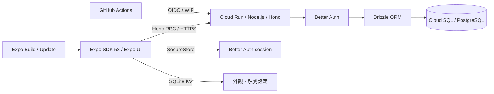

# アーキテクチャと技術選定

基準は2026年11月5日の[Expo技術選定検討](chatgpt-conversation://6aec01ec-6938-83e8-94df-24f41ae3ad55)と提供された開発仕様。依存関係の実際の解決版は `bun.lock` を正本とする。

## 採用構成

- Node.js 24、Bun 1.4.4、Expo 58、React Native 0.88、React 19.3。ネイティブ依存は `expo install` で互換版を選ぶ。
- Bun Workspaces + Turborepo。モバイルのネイティブモジュールを一つに解決するため、Bunの **hoisted linker** を明示する。
- Expo Routerは画面ルーティング専用。Honoを別サーバーとしてCloud Runで動かす。
- `@starter/api/contract` は `AppType` のtype-only公開入口。モバイルはHono RPCの型を再利用し、API実装をbundleへ混入させない。
- Zodは入力検証と共有モデル、DrizzleはPostgreSQLスキーマとmigrationを所有する。Drizzle ORM / Kitは `1.0.0-rc.5` に固定する。
- Better Auth 1.7.17 + Expo pluginでGoogle／Apple OAuth・email magic link・passkey。セッションはSecureStore。ローカルはVercel Emulateを使い、Google Cloudや実プロバイダのキーなしで認証する。

Drizzle 1.0 RCは[公式の移行手順](https://orm.drizzle.team/docs/upgrade-v1)に従って採用する。DB接続は `drizzle({ client: pool })` を使い、認証のschemaはBetter Authのadapterへ渡す。Kitで廃止された `strict` 設定は削除した。既存migrationは `drizzle-kit up` でSQLとsnapshotを同じディレクトリへ移し、snapshotをversion 9へ変換した。SQLの内容・ハッシュと適用順序は保持し、テーブルの作り直しは行わない。

## UIと端末内データ

下のタブはPlan Aのメイク・提案・投稿・マイをNative Tabsで構成し、マイはPlan Aの⑰マイページで、歯車から⑰-2プロフィール設定を開き、アプリの設定（外観・触覚・パスキー）は⑰-2の「アプリの設定」から開く。メイクの流れ（①②③⑤⑥⑦⑩⑪）はFigma Plan Aの見た目を再現し、①⑤のレシピはAPIから読む（下記）。手順・ARの重ね表示・⑥の商品詳細と、まだAPIを読まない画面（⑦⑩⑪・提案・マイ）のレシピは `src/components/recipes.ts` の固定データで持つ。画像を含むため、`src/lib` ではなくUIと同じ層に置く。色と文字はFoundationsの値を `global.css` へ追加し、ネイティブのアイコン色は `useTokenColor` で同じCSS変数から読む。投稿タブはPlan Aの⑫-1（動画を撮る）を開き、⑫-2〜⑫-9は `src/app/post` のStackで進む。撮影・手順書の作成・投稿の送信は作らず、下書きは `PostDraftProvider` が端末内の画面状態として持ち、流れを抜けると捨てる。既存のSNSサンプルのタイムラインは同じタブのStackの `/timeline` に残し、ログイン後の「タイムラインに戻る」から開く。X型のFlatList、投稿、反応はReusables Text／Button + Uniwind Free 1.13.2／Tailwind CSS 4.3.4、設定とOS操作は共通 `@expo/ui`。SF SymbolsとMaterialの両ソースを指定する。

起動画面（⓪）は、フォントの読み込み中にRoot Layoutがアプリ内の画面として表示する。ネイティブのスプラッシュは新しいビルドが必要なため変えない。ロゴの文字はフォントの読み込み前なのでシステムフォントで描く。ログイン（⑱）はPlan Aのライト配色で、ログイン成功後と「ゲストで参加」ではログインを求めた元の画面へ戻り、履歴がなければメイクへ移る。メールのリンクから戻る場合は従来どおり投稿タブを開く。

レシピはAPIの `recipe`・`product`・`recipe_product` 表に置き、未ログインでも `GET /api/recipes`（20件ずつのoffsetページング）と `GET /api/recipes/:id` で読める。レシピのIDは `fox` のような英小文字・数字・ハイフンのslugで、固定データの手順と同じIDで結び付く。⑤は手順の固定データがあるレシピだけPlan Aの注釈付きの写真・手順・「メイクをはじめる」を出し、ないレシピは完成写真を出して開始を準備中にする。⑥はPlan Aの商品詳細データがある商品だけ開く。いいね数はお気に入りを作るまで表示用の列で持つ。画像はAPIが `/sample-recipes/*` で配り、DBにはAPI上のパスか絶対URLを保存する。

SNS取り込み（④）は、ホームの「動画URL」からルートStackのformSheet `/import` を開き、入力・読み取り中・完了・失敗・保存完了を一つのシート内の状態で切り替える。取得方法と権利条件が未決のため、URLは端末内で対応サービス（Instagram・YouTube・TikTok）の投稿URLかを判定するだけで、通信せず固定の見本（`src/components/sns-import-sample.ts`）を表示し、何も保存しない。④-4はシートの上に `fullScreenModal` で重ねる。iOSのネイティブStackはモーダルの後に通常のpush画面を置くとシートの下へ積むため、戻るとシートへ帰れるようにモーダルを重ねる。④-4の保存は `dismissTo` で `saved=1` を渡し、シートを④-5にする。

マイページ（⑰）は、名前と写真をセッションから表示し、顔タイプ・フォロワーなどの数字・投稿の一覧はPlan Aの見本として「見本です」と画面に書く。ログインしていない場合はゲストとしてログインへの入口を出す。⑰-2の表示名は、以前のプロフィール編集と同じ `authClient.updateUser` で保存する。ユーザーID・自己紹介・顔タイプ・公開と通知・写真の変更・アカウントの削除は準備中として無効にする。Plan Aの⑰-2にある「パスワード」の行は、パスワードログインを設けない方針（[認証](auth.md)）のため置かない。Plan Aで非表示の⑮コスメ一覧と⑰-3〜⑰-6持っているメイク品は作らない。⑯色味チェックは、どの商品から開くかの設計ができるまで作らない。

提案タブ（⑬⑭）は、カメラ・写真選択・顔の診断を作るまで固定の見本を表示する。⑬の「前回の診断」は見本の⑭を開き、⑭には見本の結果であることを画面上に書く。⑬の「顔の形を見ています…」は飾りとして読み上げから外す。写真はどこにも送らない。

顔追跡（要件定義11章のPoC-1、#25）は、アプリ内のExpo Module `apps/mobile/modules/face-tracker` が持つ。ネイティブのビューが前面カメラ（iOSはAVFoundation、AndroidはCameraX）を開き、各フレームを端末内でMediaPipe Face Landmarkerの `LIVE_STREAM`（iOSは `MediaPipeTasksVision` 1.0.0、Androidは `com.google.mediapipe:tasks-vision` 1.2.2）に渡す。特徴点は、正立・左右反転なしのフレームに対する0〜1の座標としてビューのイベントでJSへ送り、`src/lib/face-landmarks.ts` がプレビューと同じ拡大・切り抜き・左右反転で画面座標へ写す。確認画面はReact Native Skia（2.14.0）で点を描く。映像も特徴点もサーバーへ送らない。ただしMediaPipe Tasks（Android、tasks-core 1.2.2）は、利用統計（パッケージ名、アプリの版、タスク名、実行モード、CPU・GPU別の入力数、遅延、エラーコード）をGoogleのdatatransportで送る。映像と特徴点は含まない。エミュレーターのlogcatで送信の予約（`COREML_ON_DEVICE_SOLUTIONS`）を確かめた。ストアのデータの申告に関わるため扱いを決める必要があり、iOS（`MediaPipeTasksVision`）が送るかはまだ確かめていない。Androidはプレビューを `PreviewView` の `PERFORMANCE`（SurfaceView）で出す。`COMPATIBLE`（TextureView）は毎フレームの映像をアプリの描画スレッドが写すため、エミュレーターでは画面全体の描画が遅れた。推論はGPUを先に使う。GPUの推論器は作ったスレッドでしか使えないため、作成・推論・切り替え・終了をすべて解析スレッドで行う。GPUを開けないとき、エラーが届いたとき、150フレーム（30fpsで約5秒）続けて結果が返らないときにCPUへ切り替える。tasks-vision 1.2.2は、フレームを送る途中で起きたGPUのグラフのエラーをログに出すだけで、エラー通知を呼ばないため（エミュレーターのGLで確認）。カメラには `setTargetFrameRate` で30fpsを求める。指定しないとエミュレーターのカメラは15fpsになった。CameraXはアプリ全体で共有するため、外すのはこのビューのユースケースだけにする。iOSはCPUの推論とカメラ既定のfpsのまま（実機で試せていない）。モデル `face_landmarker.task`（float16の版1、Apache-2.0、SHA-256 `64184e229b263107bc2b804c6625db1341ff2bb731874b0bcc2fe6544e0bc9ff`）はモジュールの `assets/` に1つだけ置き、iOSはモジュール直下のpodspecのresource bundle、AndroidはGradleのassetsから読む。比較した案のうち、react-native-vision-camera v5はフレーム処理のプラグインをNitro Moduleとして自作する必要があり依存も増える。`react-native-mediapipe` は2024年以降更新がなく、旧版のvision-camera前提。`react-native-vision-camera-face-detector` はML KitでMediaPipeではない。そのため、Expo Modules APIでカメラと推論を一つのビューにまとめた。モバイルの境界は `mobile-native`（`apps/mobile/modules/*`）を加え、UI層からだけ使う。Expo Goにはこのモジュールがないため `requireOptionalNativeModule` で読み、なければ案内を出す。確認用の `/face-tracking` は開発ビルドでだけ開ける（`Stack.Protected`）。⑦へ組み込む #31 で消す。

塗る範囲の重ね表示（要件定義11章のD案、#26）は、MediaPipeの標準メッシュ `canonical_face_model.obj`（コミット `a908d668`、Apache-2.0）を `src/lib/canonical-face-model.ts` に文字列のまま写して持つ。Metroは `.obj` を中身を読めないassetとしてしか扱わず、読むには別のネイティブモジュールが要るため。Jestで元のファイルのSHA-256と一致することを確かめる。`src/lib/face-mesh.ts` が三角形の各角から頂点番号とUV番号を別々に引き、頂点ごとのUVを作る。標準メッシュでは468頂点がそれぞれUVを1つだけ持ち、頂点番号とUV番号が一致する頂点はない。描画はReact Native Skiaの `Vertices` で、頂点に画面上の特徴点（先頭468点）、テクスチャ座標にUVを渡し、`ImageShader` でテクスチャを貼る。仕上がりの色は `BlendColor` の `modulate` で掛ける。Skiaの `multiply` はテクスチャが透明な所にも色を塗るため使わない。前髪の上に乗る色は、髪の切り出しまで不透明度0.7で抑える。カメラと推論は #25 のネイティブのビューのまま、特徴点をJSのSkiaで描くため、GLは使っていない。眉のテクスチャ `assets/textures/brow.png`（1024×1024、白と透明度だけ）はこのリポジトリで作った。MediaPipeの `face_mesh_connections.py` の眉の輪郭（右 `46 53 52 65 55 107 66 105 63 70`、左 `276 283 282 295 285 336 296 334 293 300`）をUV空間の多角形として塗り、眉尻から眉頭へ不透明度を約0.97から0.45へ下げた。MediaPipeのUVの参照画像 `uv_visualization.png` に重ねて眉の位置と合うことを確かめた。

チークとシェーディング（#27、PoC-2）のテクスチャ `assets/textures/cheek.png` と `shading.png` も、眉と同じ形式（1024×1024、白と透明度だけ）でこのリポジトリで作った。範囲はサンプルの狐メイクの手順画像（`assets/plan-a/ar/overlay-4.png`・`overlay-5.png`）に合わせ、MediaPipeの特徴点番号を通る折れ線を太い筆でUV空間に塗ってぼかした。標準メッシュのUVは u=0.5 で左右対称（ずれは1024pxで最大1.2px）なので、顔の右側（画像の左半分）を塗って左右反転で反対側を作る。番号は右側（左側）で示す。チークは頬骨の高い位置からこめかみへ `50 116 34`（`280 345 264`）で、筆の不透明度を始点の0.9からこめかみの0.5へ下げる（ぼかした後の最大は約0.78）。手順の「小鼻の底辺より下はNG」に合わせ、小鼻の下端 `98`（`327`）の高さより下を消す。シェーディングは、おでこの端 `103 54 21`（`332 284 251`）、こめかみから顔の横 `162 127 234`（`389 356 454`）、頬骨の下から口角へ `93 177 213`（`323 401 433`）、フェイスライン `58 172 136 150`（`288 397 365 379`）、眉頭から鼻筋の横 `55 245 188 174`（`285 465 412 399`）、鼻先の下側 `238 94`（`458 94`）、あご先 `171`（`396`）。顔の輪郭（`FACEMESH_FACE_OVAL`）に沿う線は、メッシュの外側が描かれず半分に切れるため、鼻先 `1` の方向へ約30px内側に寄せた。どちらも `uv_visualization.png` に重ねて手順画像の位置と合うことを確かめた。確認画面では眉・チーク・シェーディングをそれぞれ切り替えて重ねられる。色は `foxSteps` のもの（チーク `#B8754F`、シェーディング `#A17B60`）で、どちらも不透明度0.8で描く。顔型の違う人で範囲がずれないかは、#27で撮影して確かめる。

独自UIはCSSのneutralテーマ、標準UIはOSセマンティックカラー。端末内の外観設定から `Uniwind.setTheme` へ一本化して連動する。Portal・Reanimated等は追加しない。[UI開発手順](ui.md)を参照。

外観と触覚は `expo-sqlite/kv-store`。投稿といいねはPostgreSQLに保存し、ログインユーザーに紐付く。以前の習慣・お気に入り・完了・目標はSNSサンプルから除いた。API未設定時は接続案内を表示する。

## APIと認証の境界

`tablecast-poc/apps/api` のcomposition rootとモジュール公開入口を参考に、`app.ts`、`platform/env.ts`、`db`、`modules/auth`、`modules/social` へ分離した。organization／店舗・Cloudflare固有処理は持ち込まない。公開RPCは `contract.ts` の型だけ。

Better Authが認証し、Honoの `requireSession` と所有者条件が投稿・削除・いいねを認可する。入力はZod、いいねは複合主キーで冪等。公開フィードは著者ID・表示名・画像だけを返し、メールを公開しない。マジックリンクは10分・単回利用・ハッシュ保存、WebAuthnは署名／challenge／originを検証する。共通rate limitはDB保存。

Google／AppleのEmulate issuer・JWKS・token endpointを使うgenericOAuthを開発時だけ登録する。実署名のID tokenを検証し、認証バイパスは設けない。本番でのEmulate起動と公開エミュレータURLを拒否する。メールはResend互換エミュレータへ送る。[設定と検証](auth.md)を参照。

`eslint-plugin-boundaries` がAPI composition root→module、social→authの公開入口、module→DB/platform/shared、モバイルroutes→UI→lib、型のみのAPI契約を強制する。禁止方向・内部ファイルの直接import・未知ファイルはエラー。`scripts/boundaries.test.ts` で許可・禁止例を実際のESLintへ通す。

## worktreeと開発プロセス

アプリの表示名、保存prefix、Better AuthのアプリIDは `nuri`。両OSのアプリIDは `com.kcvl.nuri`。URLスキームもアプリIDと同じ `com.kcvl.nuri` にする。ログインの戻り先のdeep linkはセッションを含むため、他のアプリと重なりにくい逆ドメイン形式（RFC 8252 §7.1）を使う。スターターの識別子（`expo-hono-opentofu-starter`、`dev.reohakase.expohonopentofustarter`）との互換処理・端末データの移行は設けず、新しいビルドと保存領域を使う。Expoはowner `kcvlb4`・slug `nuri` のprojectへ接続し、fingerprintでネイティブ互換性を管理する。workspaceのpackage名（`@starter/*`）、ローカル・CI・Cloud SQLのDB名とユーザー名は利用者に見えない内部名なので、スターターの名前のまま残す。

アプリアイコンの原本は [Figma の Logo/nuri](https://www.figma.com/design/dwoWsLmVBU5c0Hx0vlVWua/?node-id=255-7900) を書き出した `apps/mobile/assets/plan-a/start/logo.svg`。iOSとWebのファビコンは白背景の1024px PNGを共用する。Androidはマスクの安全領域に収めた透過PNGを、通常時の前景とテーマ付きアイコンで共用する。iOSとAndroidのホーム画面へ反映するにはネイティブビルドを作り直す。

Compose標準のディレクトリ名からproject名を決める。作業用worktreeは `nuri-<issue>-<topic>` とし、ホスト内で名前を重複させない。POSIXの初期化処理はルートのGit管理外 `.env` に、実パスへ正規化したマウント先だけを生成する。アプリenvとsecretは各checkoutに置く。

ローカル実行はDocker Composeに統一し、ホストのPortless 0.16.0の[Compose連携](https://portless.sh/commands#docker-compose)でAPI・Metroの公開ポートとrouteを管理する。共有HTTPS/443 proxyを使い、ホスト名は `<service>.<Compose project名>.localhost`。コンテナ内の8080/8081は固定し、Portlessがloopback上の空きポートへ書き換える。DB等の非HTTPポートはPortlessの書換対象外なので、PostgreSQLはCompose内部の5432だけで待ち受ける。通常のMetroは `EXPO_PACKAGER_PROXY_URL` でbundleの公開URLもPortlessへ向け、Expo Go構成では空に戻してトンネルを優先する。

Composeの `setup` が依存導入・未作成env生成、`migrate` がDB healthcheck後のmigrationを担当する。APIはmigration完了後、Metroはsetup完了後に起動する。独自の子プロセス監視・ポート解決・ホストとコンテナの二重実行経路は廃止した。CI/Cloud Runは生のpackageコマンドで明示DATABASE_URLを使う。Turborepoは検査・テストの依存順とキャッシュを担当する。

Compose project名でDB、ネットワーク、依存関係・認証設定のvolumeを分離する。Bunのdownload cacheはrootの `node_modules` volume内に置き、Linuxのhardlinkでインストール先との重複保存を避ける。checkoutとGit共通ディレクトリは同じ絶対パスへmountする。Dev Containerの `workspace` は編集用であり、API・Metroを起動・再作成しない。API・Metroの `up` / `down` は必ずホストのPortlessを通し、同一projectへの再度の `up` はCompose標準どおり再利用・更新する。

仮想端末では端末用Compose overrideで公開HTTPS originを揃え、開発ビルドからMetroとAPIへ接続する。Device HubはSDKのあるホストで起動する。AndroidではユーザーCA信頼をdebugのlocalhostだけに限定する。Expoの接続モードとQRは標準CLIを使う。実機ではMetroを `compose.go.yaml` のExpo Goトンネル構成で起動し、APIは別のHTTPSトンネルまたはCloud Runへ接続する。認証URLは明示のトンネルURLを優先し、空の場合だけ開発用Compose originを使う。本番にはこの補完を適用しない。

設定とSecureStoreはインストール済みアプリ単位であり、worktree別アプリIDは生成しない。端末で複数worktreeを切り替える場合、APIのログイン状態を確認する。各APIのDBとsecretは独立する。

GCPのリソースprefixは正式名称と環境名から決める。サービスアカウントとWIF poolだけは、22文字を超えるprefixを先頭13文字とSHA-256先頭8文字（ハイフン区切り）へ短縮する。既存stateの切替・リソース置換は自動実行しない。

## 品質ゲート

- Oxlint: Expo公式 `oxlint-config-universe/native` とNode設定、型付き解析。unsafe、未処理Promise、循環import、Hooks、テストの `.only` / skipを検査。
- ESLint: Perfectionist、正規表現、複雑度、Hono、Drizzle、Turborepo、Testing Libraryなど、Oxlint本体と重複させない補完ルールだけ。依存境界は `eslint-plugin-boundaries`、type-onlyの `no-restricted-imports`、packageの公開exportsで制限する。
- Oxfmt: 現在のCLIが正式対応する `.oxfmtrc.json` を使用。仕様案の `oxfmt.config.ts` に固執しない。
- Fallow: Expo Routerとworkspaceの公開入口を検出。ネイティブautolinkingやBabelが利用する依存、トンネル用CLIだけを明示的に除外する。
- Lefthook: stagedファイルの整形/lintとCommitlint。Conventional Commitsを要求し、Gitmoji・Issue番号は必須にしない。
- Bun Test: 共有ロジック、HTTP契約、実DB認証。Jest + jest-expo + RNTL: モバイルの画面操作。Maestro: 必要時だけ。

Jestのtransform設定にはBunのisolated配置も許可している。React Native 0.88のFlow/ESMを正しく変換するためで、テスト対象のアプリコードを除外しない。

## インフラと配信の所有者

OpenTofuはAPI有効化、Artifact Registry、Cloud SQL、DB、DBユーザー、サービスアカウント、IAM、WIF、Secret Managerの器、Cloud Runサービスとmigration Jobを管理する。

DBパスワードはOpenTofuのephemeral変数とGoogle providerのwrite-only引数を使用する。Secret Managerの**値**は手動投入し、コードやstateへ複製しない。bootstrap用GCS bucketはversioning、public access prevention、削除防止付き。

GitHub Actionsはmainの成功したCIに紐づくSHAだけをデプロイする。コンテナをdigestで指定し、migration Jobを完了させ、トラフィックなしのcandidate revisionで `/ready` を確認してから切り替える。その後に同じSHAのExpo Workflowを呼ぶ。本番配信には別途有効化フラグが必要。

WIFはGitHubの不変repository ID、リポジトリ名、main、`deploy.yml`に制限する。CIのサービスアカウントはインフラ管理者ではない。インフラ変更はADCでplanを確認して適用する。

PRのExpo Updateは、tablecast-pocの手動カタログ配備と同じコメント内チェックボックス、またはGitHub Actionsの手動実行で公開する。PR更新時はコメントだけを更新する。Expo Workflowsの無料実行時間を消費しないよう、bundle生成と公開はGitHub ActionsとExpo公式preview actionが担当する。配信先はPRごとのbranchで、共有staging APIを使う。PR単位のDB/API環境は初期構成に含めない。OTAの互換性境界はfingerprint。ネイティブ依存・設定が変わると新しいビルドが必要になる。

## 参照

- [Expo SDK 58](https://docs.expo.dev/versions/v58.0.0/)
- [Expo UI](https://docs.expo.dev/versions/v58.0.0/sdk/ui/)
- [Better Auth Expo統合](https://www.better-auth.com/docs/integrations/expo)
- [Expo Workflows](https://docs.expo.dev/eas/workflows/syntax/)
- [Expo MCP](https://docs.expo.dev/mcp/)
- [OpenTofu ephemerality](https://opentofu.org/docs/language/ephemerality/)
